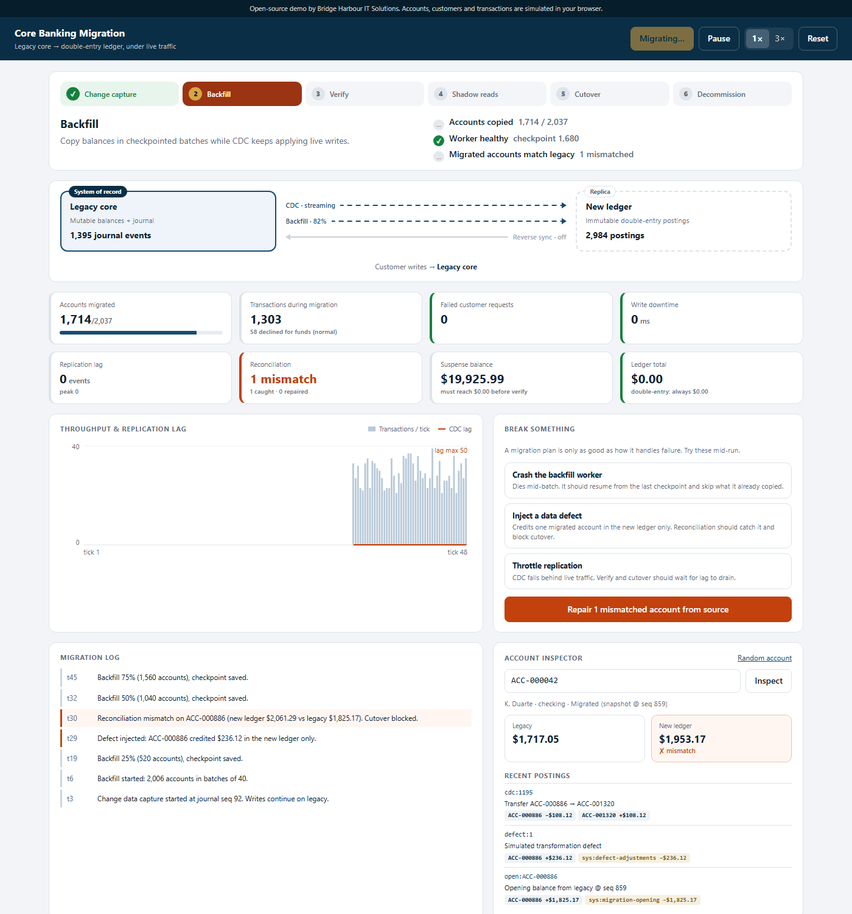

# Core Banking Migration — Demo

A live simulation of a zero-downtime migration from a legacy core banking system to a modern double-entry ledger. Customers keep transacting the whole time, and you can break things along the way to see how the migration copes.

**[Live demo →](https://saisampath138.github.io/core-banking-migration-demo/)**



> **This is an open-source demo, not client code.** Relevanz Technologies built it to show the approach behind migrations like the one in our *Core Banking Modernization* case study. Client code stays private. All accounts, customers and transactions are simulated in the browser, scaled down to about 2,000 accounts so the whole migration plays out in under a minute.

## The approach

| Phase | What happens | Gate to move on |
| --- | --- | --- |
| **Change capture** | Start tailing the legacy journal *before* copying anything, so no write is missed. | Connector running |
| **Backfill** | Copy balances in checkpointed batches. Each copy records the journal seq it was read at. | All accounts copied |
| **Verify** | Wait for replication to catch up, then reconcile every account. | Lag 0, 0 mismatches, suspense $0, ledger sums to 0 |
| **Shadow reads** | Serve reads from legacy, compare each one against the new ledger. | 600 consecutive clean reads |
| **Cutover** | Drain replication, flip writes to the new ledger, mirror back to legacy so rollback stays possible. | Clean soak period |
| **Decommission** | Legacy goes read-only. | — |

**How backfill and live writes avoid double-counting** (`src/lib/migration.ts`):

- When an account is backfilled, its opening balance is stamped with the journal sequence number it was read at.
- Change capture then applies an event to that account only if the event is **newer** than the stamp. Older events are already in the opening balance.
- Events for accounts not backfilled yet are parked in a **migration suspense account**. They're released when the account is copied, so suspense must return to exactly $0.00 before verification can pass.
- The new ledger is **double-entry** (`src/lib/ledger.ts`): every posting's legs sum to zero, so the whole ledger always totals $0.00. That gives a cheap, global integrity check.
- Postings are **idempotent by transaction id**. Replaying a batch after a crash can't double-count.

## Break something

Run these during the migration:

- **Crash the backfill worker.** It dies halfway through a batch, before saving a checkpoint. On restart it resumes from the last checkpoint and skips the accounts it had already copied.
- **Inject a data defect.** One migrated account is credited in the new ledger only. Continuous reconciliation flags it on the next tick and blocks cutover. Repair posts an auditable adjustment derived from the source of truth.
- **Throttle replication.** Change capture falls behind live traffic. Verify and cutover wait for the lag to drain.

## Running it

```bash
npm install
npm run dev      # http://localhost:5173
npm test         # Vitest: full migrations under traffic, crash/drift/lag scenarios
npm run build    # type-check + production build into dist/
```

The tests run complete migrations and assert that every account matches between the two systems, suspense is zero, the ledger sums to zero and no customer request failed. They also cover a crash mid-backfill, an injected defect (cutover must stay blocked until it's repaired), a replication slowdown, and reverse sync during the soak.

## How it's built

```
src/
  lib/
    legacy.ts          legacy core: mutable balances, journal, overdraft checks
    ledger.ts          double-entry ledger: balanced, idempotent postings
    migration.ts       orchestrator, traffic generator, CDC, backfill, reconciliation, cutover
    migration.test.ts  scenario tests
  main.ts              dashboard: phases and gates, data flow, KPIs, chart, log, account inspector
```

**What's simplified.** Everything runs in one process, so "atomic" steps really are atomic here. In production the snapshot read and its stamp would come from one database transaction, change capture would come from the database's log (for example Debezium on the write-ahead log), and cutover would use a brief write fence, typically under a second, rather than an instant flip. The ordering, gates and invariants are the same.

## Deployment

Each push to `main` runs the tests, builds, and publishes `dist/` to GitHub Pages (`.github/workflows/deploy.yml`).

## License

[MIT](LICENSE)
